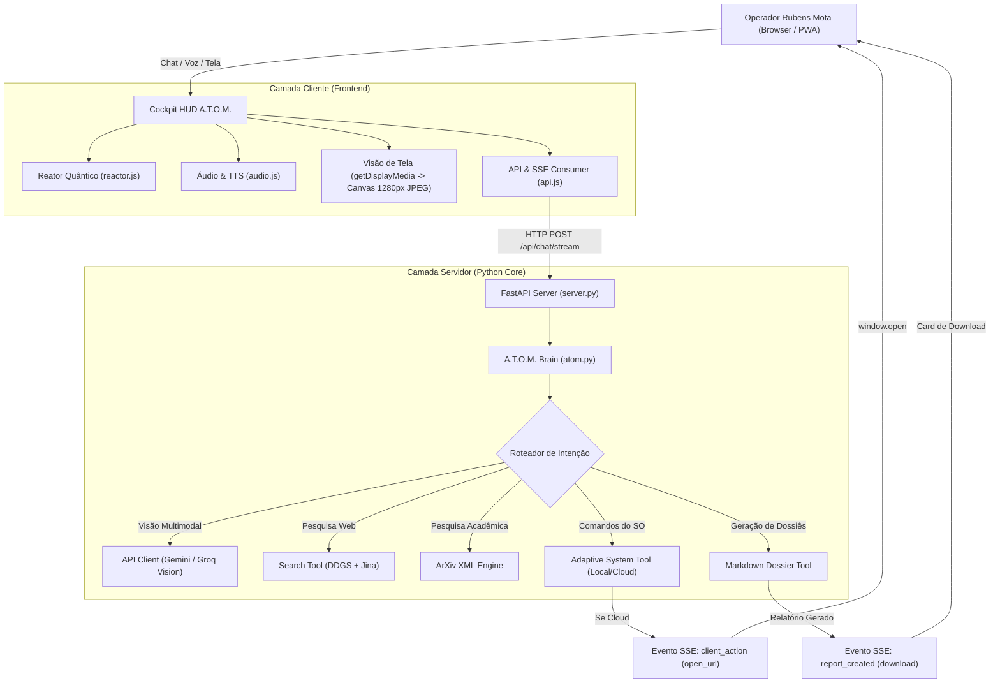

<!--
Data/Hora: 2026-10-15T20:10:00-03:00 (UTC-3)
Branch: Web-Atom
Commit: 7dce1c2
Status: Atualizado
-->

# Arquitetura Geral do Sistema — A.T.O.M.

Este documento detalha o fluxo de dados, a arquitetura híbrida e a orquestração multimodal do **A.T.O.M. (Artificial Tactical Operating Matrix)** concebido por Rubens Mota.

---

## 1. Visão Arquitetural

---

## 2. Otimização de Visão Multimodal
Para viabilizar a percepção de tela em containers leves na nuvem (Render, 512MB RAM) e prevenir gargalos de rede:
1. O usuário aciona `#screen-share-btn`.
2. A API nativa `navigator.mediaDevices.getDisplayMedia` obtém o stream de vídeo.
3. No momento do envio da ordem pelo operador, o frame ativo do vídeo é capturado em um `<canvas>` offscreen.
4. O canvas redimensiona a imagem dinamicamente para uma resolução máxima de **1280px**, mantendo a proporção.
5. A imagem é comprimida em **JPEG com fator de qualidade 0.75**, gerando um payload leve de aproximadamente 120KB a 180KB em base64.
6. O frame é injetado no payload do Google Gemini via `types.Part.from_bytes` ou Groq Vision via `image_url`.

---

## 3. Arquitetura Adaptativa Local vs. Nuvem
A função `is_cloud_environment()` em `backend/tools/system_tool.py` inspeciona a presença de variáveis de ambiente típicas de container (`RENDER`, `PORT`, `RAILWAY_ENVIRONMENT`, `HEROKU`, `KUBERNETES_SERVICE_HOST`).

- **Quando em Ambiente Local (Windows Desktop):**
  - Comandos como abrir Calculadora (`calc.exe`) ou Bloco de Notas (`notepad.exe`) são disparados via `subprocess.Popen` no host do operador.
- **Quando em Ambiente de Nuvem (Container Linux):**
  - Tentativas de abrir aplicativos desktop do Windows são convertidas com segurança em avisos táticos amigáveis ou eventos SSE `client_action` com ação `open_url` para que o navegador do cliente abra o link em uma nova aba.
