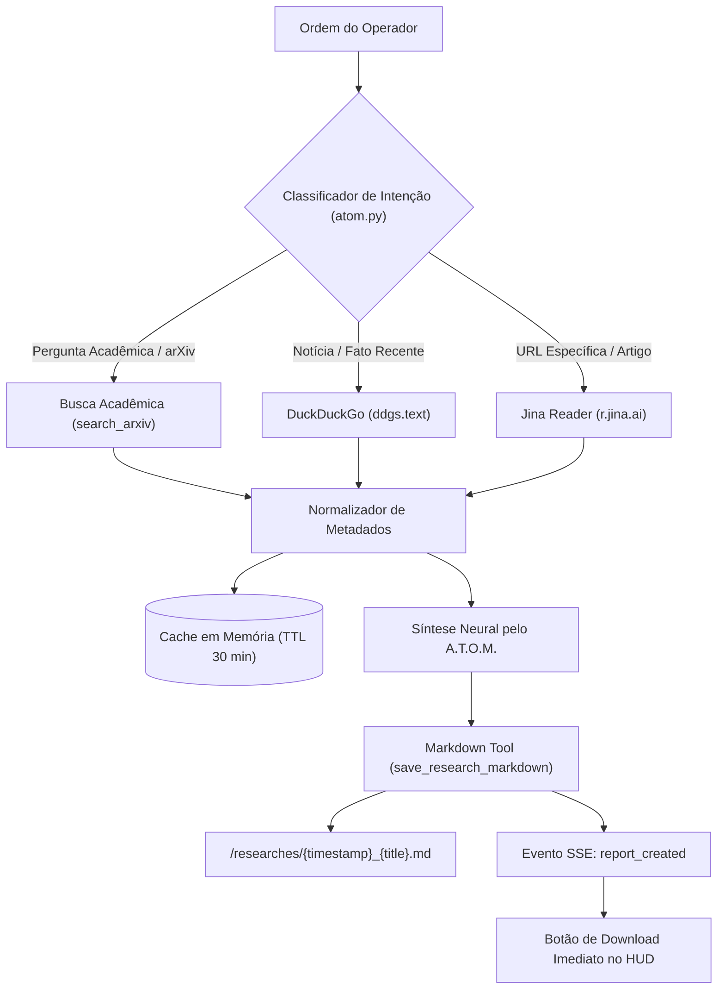

<!--
Data/Hora: 2026-10-15T22:39:00-03:00 (UTC-3)
Branch: Web-Atom
Commit: 7dce1c2
Status: Atualizado
-->

# Fluxo Operacional: Pesquisa Aprofundada & Síntese Científica

Este documento detalha o pipeline de coleta de dados web, busca acadêmica no **arXiv**, extração de conteúdo estruturado via **Jina Reader** e a persistência de dossiês táticos em Markdown.

---

## 1. Arquitetura do Pipeline de Pesquisa



---

## 2. Componentes de Pesquisa

### 2.1. DuckDuckGo Engine (`ddgs`)
Localizado em [backend/tools/search_tool.py](file:///c:/Users/Rubens/Desktop/projetinhos/jarvis%20gravity/backend/tools/search_tool.py):
- Utiliza a nova biblioteca Python `ddgs` (substituindo a antiga `duckduckgo_search` para evitar avisos de depreciação).
- Parâmetros: `max_results=5`, região `wt-wt` ou `pt-br`, filtro `safesearch='moderate'`.
- Extrai título, link e snippet textual direto de cada fonte.

### 2.2. Jina Reader Engine (`r.jina.ai`)
- Converte qualquer página HTML complexa (incluindo blogs, portais de notícia e artigos técnicos) em **Markdown puro e legível para LLMs**.
- Chamada via HTTP GET assíncrona:
  ```python
  jina_url = f"https://r.jina.ai/{target_url}"
  headers = {"User-Agent": "A.T.O.M.-Tactical-OS/2.0", "X-No-Cache": "true"}
  ```
- Trunca o conteúdo em `8.000` caracteres para manter o contexto ágil e prevenir estouro de janela em modelos compactos.

### 2.3. arXiv Academic XML API
- Consulta direta ao endpoint oficial da Cornell University (`https://export.arxiv.org/api/query`).
- Parser robusto baseado em `xml.etree.ElementTree` que extrai:
  - Título do artigo científico limpo.
  - Resumo executivo (*abstract*).
  - Autores e afiliações.
  - Identificador único (ex: `2403.12345v1`).
  - Link direto para o PDF correspondente no repositório oficial.

---

## 3. Persistência de Dossiês em Markdown

Quando o operador solicita a geração de um relatório ou resumo estruturado, o arquivo é gerado via [save_research_markdown()](file:///c:/Users/Rubens/Desktop/projetinhos/jarvis%20gravity/backend/tools/markdown_tool.py#L38-L90):

### 3.1. Estrutura do Frontmatter YAML
```markdown
---
title: "Computação Quântica e Criptografia Pós-Quântica"
date: "15/10/2026 22:30:00"
query: "quantum computing post-quantum cryptography"
tags: [Pesquisa Científica, arXiv, A.T.O.M. Tactical Intelligence]
system: "A.T.O.M. Tactical Intelligence — Artificial Tactical Operating Matrix"
author: "A.T.O.M. por Rubens Mota"
---
```

### 3.2. Rota de Download Seguro
O backend expõe a rota:
```http
GET /api/researches/{filename}/download
```
- **Proteção contra Path Traversal:** A função [get_research_file_path()](file:///c:/Users/Rubens/Desktop/projetinhos/jarvis%20gravity/backend/tools/markdown_tool.py#L18-L37) rejeita qualquer requisição contendo barras, `..` ou extensões que não sejam `.md`.
- **Cabeçalhos de Download:** Responde com `FileResponse` e cabeçalho `Content-Disposition: attachment; filename="{filename}"`, forçando o navegador a salvar o arquivo sem tentar executá-lo.
