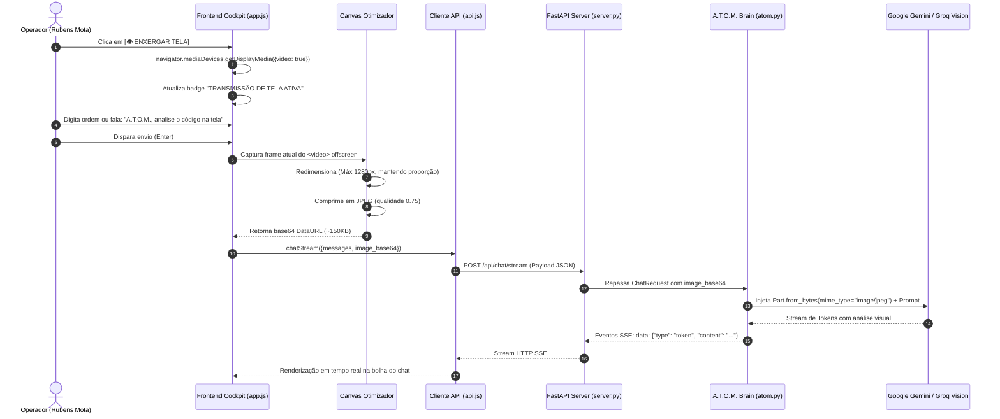

<!--
Data/Hora: 2026-10-15T22:39:00-03:00 (UTC-3)
Branch: Web-Atom
Commit: 7dce1c2
Status: Atualizado
-->

# Fluxo Operacional: Visão Multimodal de Tela

Este documento especifica o ciclo de vida da percepção visual em tempo real do **A.T.O.M. (Artificial Tactical Operating Matrix)**, abrangendo captura, otimização de largura de banda, empacotamento base64 e injeção nos modelos de IA.

---

## 1. Diagrama de Sequência da Visão Multimodal



---

## 2. Parâmetros de Otimização Visual

Para garantir que a transmissão visual não cause esgotamento de memória no backend ou travamento em conexões móveis, as seguintes diretrizes são aplicadas no arquivo [frontend/js/app.js](file:///c:/Users/Rubens/Desktop/projetinhos/jarvis%20gravity/frontend/js/app.js):

| Parâmetro | Valor Configurado | Justificativa Técnica |
| :--- | :--- | :--- |
| **Resolução Máxima** | `1280px` (dimensão maior) | Suficiente para leitura de código em IDEs e textos de alta densidade sem penalidade de tokens. |
| **Formato de Compressão** | `image/jpeg` | Redução drástica de overhead em relação ao PNG bruto. |
| **Fator de Qualidade** | `0.75` | Equilíbrio perfeito entre nitidez de tipografia e peso do arquivo (~120KB a 180KB). |
| **Frame Rate do Stream** | Ideal: `5fps`, Máx: `15fps` | Economiza processamento da GPU do cliente enquanto o operador não envia comandos. |
| **Disparo Sob Demanda** | No momento do submit | Não há envio contínuo desnecessário; o frame congelado é transmitido apenas junto com a ordem. |

---

## 3. Compatibilidade Multimodal no Backend

No arquivo [backend/core/api_client.py](file:///c:/Users/Rubens/Desktop/projetinhos/jarvis%20gravity/backend/core/api_client.py), o sistema lida de forma polimórfica com os diferentes provedores:

### 3.1. Google Gemini (SDK Oficial `google-genai` v2)
```python
raw_b64 = image_base64.split(",", 1)[1] if "," in image_base64 else image_base64
img_bytes = base64.b64decode(raw_b64)
image_part = types.Part.from_bytes(data=img_bytes, mime_type="image/jpeg")
contents.append(image_part)
```

### 3.2. Provedores OpenAI / Groq Cloud Vision
Para modelos como `meta-llama/llama-4-scout-17b-16e-instruct` da Groq:
```python
content_parts = [
    {"type": "text", "text": prompt_text},
    {"type": "image_url", "image_url": {"url": image_base64}}
]
```

---

## 4. Tratamento de Erros e Resiliência
- Se o usuário encerrar o compartilhamento nativo através do botão flutuante do sistema operacional ("Parar compartilhamento"), o evento `track.onended` dispara automaticamente [stopScreenShare()](file:///c:/Users/Rubens/Desktop/projetinhos/jarvis%20gravity/frontend/js/app.js), desligando os seletores visuais sem quebrar o estado da aplicação.
- Caso o modelo selecionado não possua capacidades visuais nativas, o backend realiza fallback transparente para `gemini-flash-latest`.
