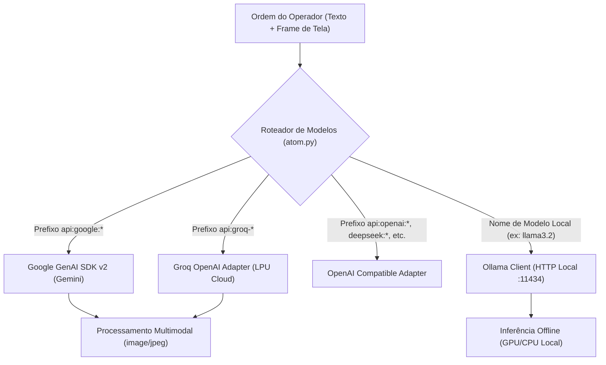

<!--
Data/Hora: 2026-10-15T22:47:00-03:00 (UTC-3)
Branch: Web-Atom
Commit: 04fe7fe
Status: Atualizado
-->

# Catálogo Neural: Modelos de Inteligência Artificial & Arquitetura Híbrida

Este documento especifica a infraestrutura de modelos de IA do **A.T.O.M. (Artificial Tactical Operating Matrix)**, detalhando os modelos em nuvem catalogados, a integração com o motor local Ollama, a matriz de capacidades multimodais e as políticas de segurança de chaves.

---

## 1. Visão Geral da Arquitetura Neural Híbrida

O A.T.O.M. implementa uma camada de abstração unificada que permite ao operador alternar instantaneamente entre **inferência local 100% offline e privada** (via Ollama) e **modelos em nuvem de ponta** (via Google Gemini, Groq Cloud, OpenAI, DeepSeek e OpenRouter).

### Convenção de Nomenclatura e Prefixos
- **Modelos em Nuvem:** Identificados pelo prefixo `api:<provider>:<model_id>` (ex: `api:google:gemini-flash-latest`, `api:groq-llama-vision`).
- **Modelos Locais:** Identificados pelo nome de tag registrado no daemon Ollama (ex: `llama3.2:latest`, `mistral:latest`, `qwen2.5:7b`).

---

## 2. Catálogo Oficial de Modelos em Nuvem

Configurados no arquivo [config/api_models.json](file:///c:/Users/Rubens/Desktop/projetinhos/jarvis%20gravity/config/api_models.json):

### 2.1. `api:google:gemini-flash-latest` — Gemini Flash (Mais Recente - Auto) ★
- **Provedor:** Google AI Studio (API v1beta / Google GenAI SDK v2).
- **ID Técnico:** `gemini-flash-latest` (aponta dinamicamente para o modelo Flash de produção mais moderno do Google).
- **Variável de Ambiente:** `GEMINI_API_KEY`.
- **Visão de Tela (Multimodal):** **Sim (Nativa)** — alta acurácia para leitura de interfaces, código, tabelas e janelas complexas.
- **Função no A.T.O.M.:** **Modelo Padrão do Sistema**. Utilizado como alvo principal de fallback visual e orquestração de pesquisa profunda.
- **Latência:** Ultrabaixa (~200ms para primeiro token).
- **Janela de Contexto:** 1 milhão de tokens.

### 2.2. `api:google:gemini-3.6-flash` — Gemini 3.6 Flash
- **Provedor:** Google AI Studio.
- **ID Técnico:** `gemini-3.6-flash`.
- **Variável de Ambiente:** `GEMINI_API_KEY`.
- **Visão de Tela (Multimodal):** **Sim (Nativa)**.
- **Perfil Operacional:** Otimizado para raciocínio lógico rápido, estruturação de código e síntese científica acadêmica com arXiv.

### 2.3. `api:groq-llama-vision` — Groq LLaMA 4 Scout Vision
- **Provedor:** Groq Cloud (aceleração por hardware LPU — *Language Processing Unit*).
- **ID Técnico:** `meta-llama/llama-4-scout-17b-16e-instruct`.
- **Endpoint Base:** `https://api.groq.com/openai/v1`.
- **Variável de Ambiente:** `GROQ_API_KEY`.
- **Visão de Tela (Multimodal):** **Sim** — suporta injeção de imagens em base64 DataURL (`image_url`).
- **Velocidade de Geração:** Superior a **300 tokens por segundo**, ideal para respostas instantâneas no cockpit HUD.

---

## 3. Integração com Motor Local (Ollama)

O arquivo [backend/core/ollama_client.py](file:///c:/Users/Rubens/Desktop/projetinhos/jarvis%20gravity/backend/core/ollama_client.py) gerencia a comunicação com o daemon Ollama na porta `11434`.

### 3.1. Modelos Locais Recomendados para o A.T.O.M.
| Modelo | Tag de Download | Tamanho VRAM | Perfil de Desempenho |
| :--- | :--- | :--- | :--- |
| **LLaMA 3.2 3B** | `llama3.2:3b` | ~2.5 GB | Excelente para comandos de SO, conversação rápida e baixo impacto no hardware. |
| **LLaMA 3.2 1B** | `llama3.2:1b` | ~1.2 GB | Ultraleve para notebooks sem GPU dedicada. |
| **Qwen 2.5 Coder** | `qwen2.5-coder:7b` | ~5.5 GB | Especialista em análise de código e comandos de terminal PowerShell. |
| **DeepSeek R1 Distill** | `deepseek-r1:7b` | ~5.2 GB | Raciocínio matemático passo-a-passo e planejamento tático. |
| **Mistral 7B** | `mistral:latest` | ~4.8 GB | Geração equilibrada de textos e síntese analítica. |

### 3.2. Download de Modelos pelo HUD (`Ollama Pull`)
O operador pode baixar qualquer modelo do repositório oficial Ollama diretamente pelo painel **⚙ SISTEMA**:
1. O usuário informa o identificador (ex: `llama3.2`).
2. O frontend chama a rota SSE `POST /api/models/pull`.
3. O backend transmite em tempo real porcentagem, bytes baixados e status de verificação.

### 3.3. Sonda Rápida de Conectividade (`is_available`)
Para evitar travamentos em deploys em nuvem (como Render e Docker, onde o daemon Ollama não existe), o método `is_available()` realiza uma sonda de socket TCP com timeout estrito de **0.8 segundos**. Se o Ollama não responder, o sistema desativa silenciosamente as opções locais e chaveia para os modelos em nuvem.

---

## 4. Matriz Comparativa de Capacidades

| Modelo | Provedor | Visão Multimodal | Velocidade | Janela Contexto | Suporte Offline | Custo / Tier |
| :--- | :--- | :---: | :---: | :---: | :---: | :---: |
| **Gemini Flash (Auto)** | Google | Sim (1280px JPEG) | Muito Rápida | 1M tokens | Não (Requer Net) | Gratuito / AI Studio |
| **Gemini 3.6 Flash** | Google | Sim (1280px JPEG) | Muito Rápida | 1M tokens | Não (Requer Net) | Gratuito / AI Studio |
| **Groq LLaMA 4 Vision** | Groq | Sim (DataURL) | Ultrarrápida (300+ t/s) | 128k tokens | Não (Requer Net) | Gratuito / Groq Cloud |
| **LLaMA 3.2 (3B)** | Ollama | Não | Rápida (GPU Local) | 8k - 128k | **Sim (100% Offline)** | Gratuito / Local |
| **Qwen 2.5 Coder (7B)** | Ollama | Não | Média (GPU Local) | 32k tokens | **Sim (100% Offline)** | Gratuito / Local |
| **DeepSeek R1 (7B)** | Ollama | Não | Raciocínio Profundo | 32k tokens | **Sim (100% Offline)** | Gratuito / Local |

---

## 5. Política de Segurança de Chaves (Zero-Persistência em Git)

O A.T.O.M. adota uma política estrita de três camadas para proteção de credenciais de IA:

1. **Camada 1 — Variáveis de Ambiente do Sistema / `.env`:**
   - As chaves podem ser definidas no arquivo `.env` na raiz do projeto (que já está explicitamente protegido no `.gitignore`).
   - Variáveis lidas: `GEMINI_API_KEY`, `GROQ_API_KEY`, `OPENAI_API_KEY`, `DEEPSEEK_API_KEY`, `OPENROUTER_API_KEY`.
2. **Camada 2 — Memória Volátil da Sessão do Navegador (`sessionStorage`):**
   - O operador pode inserir ou testar qualquer chave na interface (**⚙ SISTEMA**).
   - A chave é salva exclusivamente no `sessionStorage` da aba aberta.
   - Nenhuma chave inserida pela interface é gravada no disco ou em arquivos `.json` do repositório.
   - A chave é enviada pelo cliente no header `X-Api-Key` ou no payload JSON da requisição ativa.
3. **Camada 3 — Zero-Vazamento em Dossiês:**
   - Relatórios e dossiês gerados em `./researches/` jamais contêm logs de chaves ou credenciais.

---

## 6. Mecanismos de Fallback e Resiliência Neural

No arquivo [backend/core/atom.py](file:///c:/Users/Rubens/Desktop/projetinhos/jarvis%20gravity/backend/core/atom.py) e [api_client.py](file:///c:/Users/Rubens/Desktop/projetinhos/jarvis%20gravity/backend/core/api_client.py):

- **Fallback para Visão:** Se o operador compartilhar a tela (`image_base64` presente) e o modelo ativo for exclusivamente textual (ex: modelos locais do Ollama), o cérebro do A.T.O.M. redireciona a requisição visual automaticamente para `gemini-flash-latest` com aviso informativo no terminal.
- **Fallback de Chave Ausente:** Se a chave do provedor selecionado não for encontrada no `.env` nem na sessão, o sistema emite um evento SSE de erro instruindo o operador com links diretos para obter a chave gratuita no Google AI Studio ou Groq Cloud.
- **Sincronização Dinâmica Google Gemini:** O botão **🔄 Sincronizar da API Google** consulta em tempo real a lista de modelos liberados para a sua chave através de `GET https://generativelanguage.googleapis.com/v1beta/models`, preenchendo o HUD com as versões mais recentes disponíveis.
